# JarWis

**A smart floating control bar for Windows 11.** Your clock, mail, calendar, clipboard, music, PC performance, AI tools and even the Codex pet, all in one small island that lives on the edge of your screen.

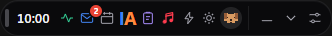

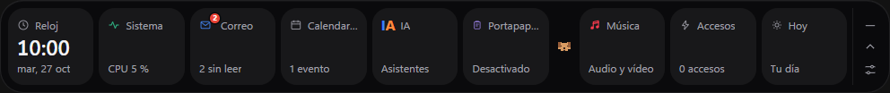

> Built with **Tauri 2 + Rust + React + TypeScript**. Real desktop app with a per-user installer (~2.3 MB, no admin rights). The UI is in Spanish.

---

## Why JarWis?

A normal workday on Windows means jumping between a dozen windows just to check small things: *Do I have new mail? When is my next meeting? What did I copy five minutes ago? Why is the fan spinning? What song is playing?* Every check is a context switch.

JarWis puts all of that **one glance or one click away**, without opening any window:

- **Glance:** the compact bar shows the time, unread mail, CPU pulse, and live badges.
- **Click:** each widget opens a panel right below the bar with the details and the actions you need.
- **Forget it:** after 40 seconds without interaction the bar compacts itself again. It can also shrink to a tiny "pill" with an animated mascot, or hide completely with a shortcut.

The goal was not another dashboard. It was to make everyday computer use **calmer and faster**: fewer windows, fewer clicks, and private data that never leaves your PC unless you say so.

---

## Features

### The bar

| Mode | What it looks like |
|---|---|
| **Compact**: icons with badges, always on top |  |
| **Expanded**: every widget with a live summary | 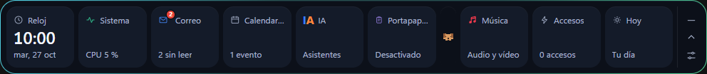 |
| **Vertical**: docked on the left or right edge | 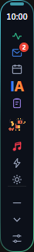 |
| **Mini pill**: minimized, with an animated mascot (air, fire, water or earth) |  |

- Dock it **top, bottom, left or right**, on any monitor. Drag it along the edge and it remembers the position.
- **Reorder widgets** by dragging (or `Alt + arrows`) and hide the ones you don't use.
- **Three finishes:** *Negro* (black), *Pizarra* (slate) and *Aurora neón* (neon), plus light/dark/system theme.
- **Auto-compact** after N seconds idle (default 40, configurable, 0 disables it).
- **Global shortcuts:**

| Shortcut | Action |
|---|---|
| `Ctrl + Alt + J` | Show / hide the bar |
| `Ctrl + Alt + K` | Restore from the pill / toggle compact ↔ expanded |
| `Ctrl + Alt + C` | Open / close the clipboard history |

### Widgets

**Today**: a one-screen summary of your day: weather (Open-Meteo, city chosen manually, no geolocation), next event, tasks and mail, plus *workspaces* (open a group of apps/links with one click), focus mode and quick launchers for Telegram, WhatsApp, Spotify, Netflix and YouTube. Empty counters are hidden, so you only see what matters.

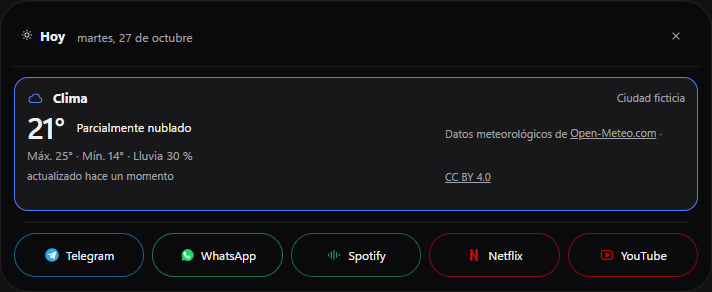

**Mail**: unread messages from Gmail (*Primary* tab only) and Outlook in one list, with *All / Gmail / Outlook* filters. Only sender and subject are shown: never the body. Clicking a message opens it in the browser. Optional Windows notification for new mail.

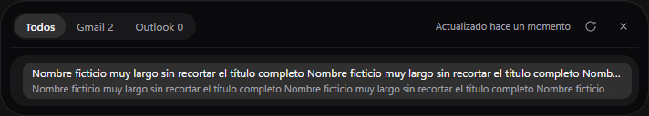

**Calendar**: Google Calendar events and Google Tasks, with a 7-day agenda and a monthly mini calendar that marks days with events or tasks.

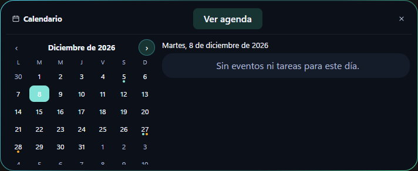

**System**: CPU, RAM, system disk, network up/down, battery and uptime, with adaptive polling (slower when the bar is compact or hidden). It can also switch the Windows 11 power mode with the documented API.

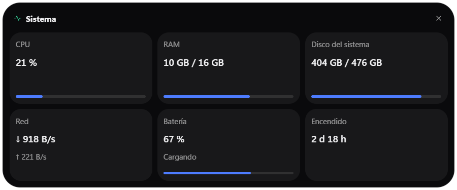

**Music & audio**: output volume and mute, quick access to change the audio device, and *now playing* controls for any app that publishes media sessions (Spotify, browsers, etc.).

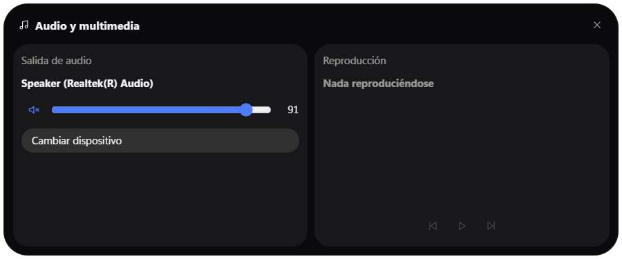

**Clock**: stopwatch, timers and alarms. They run in the Rust core (not in the web view), so they keep working while the bar is hidden, and they ring with a native Windows notification.

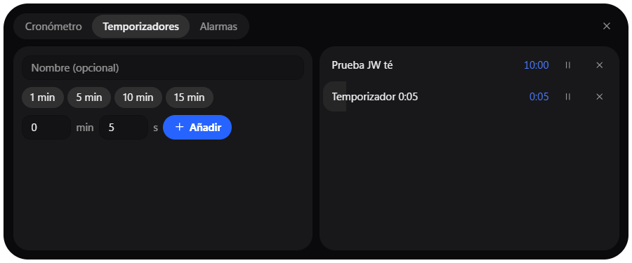

**Clipboard**: JarWis keeps its **own** text-only clipboard history, **in memory only** (nothing is written to disk): up to 50 recent items and 50 pinned ones, with search, pin, delete and copy again. Content that password managers mark as sensitive is never stored.

**AI**: one-click launchers for Claude (app and terminal), the official usage page, ChatGPT and Antigravity.

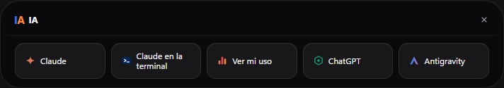

**Codex pet**: a small pixel-art button (dog or dragon) that brings up the OpenAI Codex desktop pet (it sends Codex's own `Win + Alt + P` shortcut, only when Codex is running). JarWis also ships a **Codex skill** (`jarwis-hoy`) so you can ask Codex *"what do I have today according to JarWis?"*. It reads an opt-in, sanitized summary file (task and event titles, unread counts, up to 5 senders/subjects). Turn the sharing switch off and Codex sees nothing.

**Shortcuts**: launch apps (including Microsoft Store apps), URLs, folders and files from a saved list.

### Settings

Everything is configurable from a native settings window with three tabs: Appearance, Productivity and Accounts.

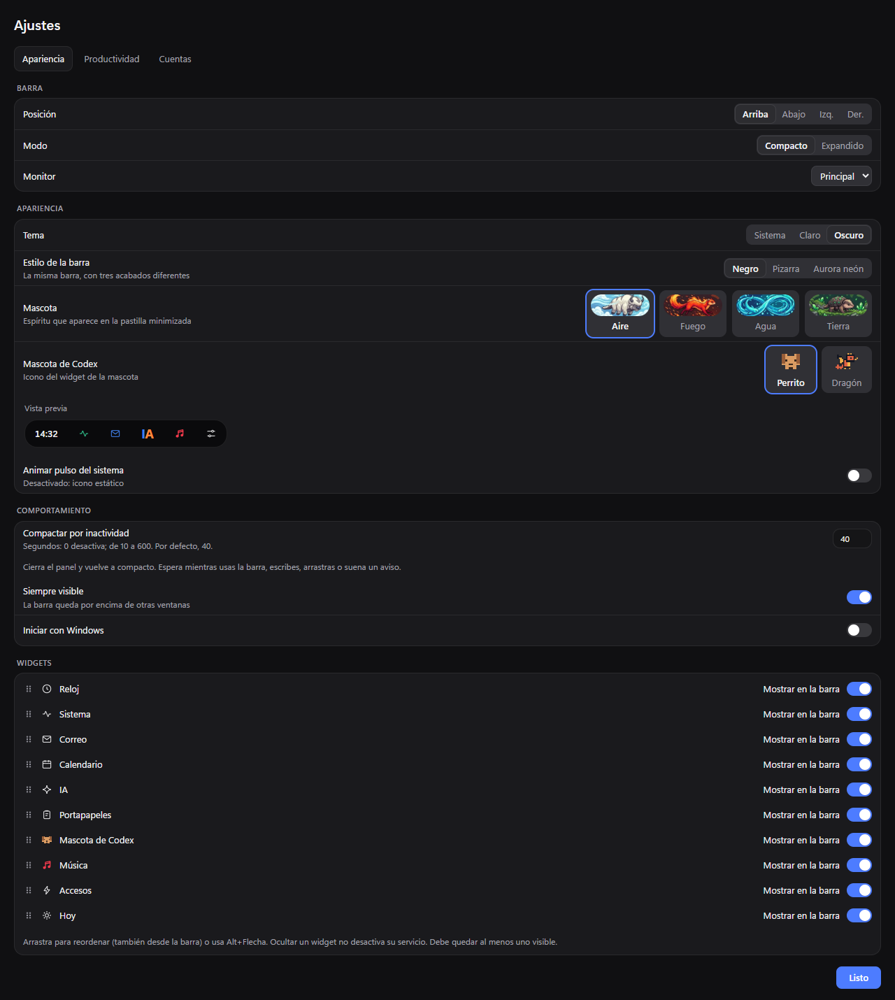

---

## Architecture

```
┌──────────── Frontend (WebView2) ────────────┐
│ React 19 + TypeScript + Tailwind 4          │
│ Floating bar · widget panels · settings      │
└──────────────┬──────────────────────────────┘
               │ Tauri IPC commands/events (capability-scoped)
┌──────────────┴──────────── Rust core (Tauri 2) ──────────────┐
│ jarwis-auth   OAuth 2 (PKCE) + Gmail/Calendar/Tasks clients  │
│ clipboard     in-memory history, sensitive-content filter    │
│ monitor/power CPU, RAM, disk, network, battery, power mode   │
│ audio/media   IAudioEndpointVolume, media sessions (GSMTC)   │
│ clock         timers & alarms + native notifications         │
│ layout        edge docking, multi-monitor, DPI, drag         │
│ shortcuts     app/URL/file launcher, workspaces              │
│ codex_pet     Codex pet trigger                              │
│ weather       Open-Meteo                                     │
│ settings      single-writer store with validation            │
└──────────────────────────────────────────────────────────────┘
```

Key design choices:

- **Rust does the work, the web view only draws.** Tokens never leave the Rust core; the frontend receives only the data it needs to display.
- **Tauri 2 capabilities** limit which commands each window can call.
- **Nothing blocks the bar.** Network or auth failures degrade to a friendly error state inside the widget.
- **Low footprint:** adaptive polling, a cheap JS "pulse" instead of a continuous CSS animation, and a release profile with LTO + `opt-level="s"` (≈3 MB executable).
- **Windows-native details** were implemented directly with Win32/WinRT through the `windows` crate: positioning with `SetWindowPos`, Store app launching via AUMID, power mode notifications, audio endpoints, media sessions.

More detail (in Spanish): [`docs/ARCHITECTURE.md`](docs/ARCHITECTURE.md), [`docs/REQUIREMENTS.md`](docs/REQUIREMENTS.md).

---

## Privacy & security by design

| Topic | How JarWis handles it |
|---|---|
| Google sign-in | OAuth 2 Authorization Code + **PKCE (S256)**, validated `state`, system browser, loopback redirect |
| Scopes | **Read-only**: `gmail.readonly`, `calendar.readonly`, `tasks.readonly` |
| Tokens | Refresh token stored in the **Windows Credential Manager (DPAPI)**; access token only in memory. Never in files, logs or the repo |
| OAuth client config | Local file in `%APPDATA%\JarWis\oauth-clients.json`, git-ignored |
| Mail content | Only sender (name or domain, max 60 chars) and subject (max 120). Never bodies, snippets or full addresses |
| Clipboard | In memory only; respects Windows' "exclude from clipboard history" flag used by password managers |
| AI sharing | Off by default. Explicit switch; turning it off, signing out or quitting purges the shared file |
| Outlook | No Microsoft Graph: Outlook mail is forwarded to Gmail and labeled, so one read-only connection covers both |

See [`docs/SECURITY.md`](docs/SECURITY.md) (Spanish).

---

## How it was built: an AI multi-agent workflow

JarWis was designed and built by one person working with **AI coding agents**, running locally on the same Windows 11 machine where the app runs. The interesting part is not only the bar but the process that kept quality and security high on a limited AI budget.

### The roles

```
User → Architect → Executor → Auditor → Architect → (commit | fix, max 3 cycles → user)
```

| Agent | Model | Job |
|---|---|---|
| **Architect** (main session) | Claude Opus | Plans, splits work into tasks with acceptance criteria, delegates, integrates, commits |
| `architect` (sub-agent) | Claude Opus | Read-only research: official docs, API feasibility, design |
| `simple-executor` | Claude Sonnet | UI, styles, copy, config, small fixes |
| `complex-executor` | Claude Opus | Rust, Win32, OAuth, persistence, concurrency |
| `auditor` | Claude Sonnet | Independent review of regular changes |
| `security-auditor` | Claude Opus (high effort) | Mandatory review for auth, tokens, personal data, external services |
| **Codex** (OpenAI, via the Codex plugin for Claude Code) | high effort | Took over as main executor in later phases; a *separate* Codex run audited each delivery |

The agent definitions live in [`.claude/agents/`](.claude/agents) and the shared rules in [`.claude/rules/`](.claude/rules) and [`CLAUDE.md`](CLAUDE.md). The full process is in [`docs/AGENT_WORKFLOW.md`](docs/AGENT_WORKFLOW.md).

### Where the agents run

- **Claude Code** (desktop app) on the local Windows PC, with the project in a short path outside OneDrive (OneDrive locks build files and long paths break MSVC linking).
- Sub-agents are spawned by the main Claude Code session; Codex runs through its CLI from the same session.
- The repository was **local-only** during development; publishing, installing software, touching Windows settings or opening any login page required explicit user approval.

### Rules that made it work

- **Nobody audits their own work.** Every change gets an independent review; auth and personal data always go to the security auditor.
- **"Implemented" ≠ "verified".** Each task ships with evidence: automated UI runs in headless Edge with a fully mocked IPC (fictional data only), native probes for window flicker and geometry, and Rust unit tests. Scripts live in [`src-tauri/tests-manual/`](src-tauri/tests-manual) and are reused instead of rewritten.
- **Agents never see private data.** Test output prints only neutral metadata (counts, IDs, dates, sender domain). Full content is shown only when the user runs a `--show` flag themselves.
- **Every decision is recorded** (80+ entries in the decision log), every task in a progress log, every review in an audit log.
- **Token budget by layer:** expensive models only for Rust/Win32/security, cheaper models for UI; short reports (≤ 40 lines) with details in files; one session per phase, with state kept in docs and Git instead of long conversations.

The result: ~50 tracked tasks, ~100 commits and ~14k lines of Rust/TypeScript built over about two weeks.

---

## Install / build from source

### Requirements

- Windows 11 (x64)
- [Rust](https://rustup.rs) stable with the **MSVC** toolchain
- Visual Studio Build Tools with the **C++ desktop** workload
- Node.js 24+
- Microsoft Edge WebView2 Runtime (included in Windows 11)

> Tip: clone into a short path such as `C:\dev\JarWis`. Long paths can make the MSVC linker fail (260-char limit).

### Run in development

```bash
npm install
npm run tauri dev
```

### Build the installer

```bash
npm run tauri build
```

This produces a per-user NSIS installer (no admin rights) at
`target/release/bundle/nsis/JarWis_0.1.0_x64-setup.exe`. Run it and open JarWis from the Start menu.

### Connect Google (optional)

Mail, Calendar, Tasks and the Today summary need your own Google OAuth client (free, for personal use):

1. Create a Google Cloud project, enable Gmail, Calendar and Tasks APIs, and create an OAuth client of type **Desktop app**.
2. Copy [`crates/jarwis-auth/oauth-clients.example.json`](crates/jarwis-auth/oauth-clients.example.json) to `%APPDATA%\JarWis\oauth-clients.json` and fill in your `client_id` and `client_secret`.
3. In JarWis: *Settings → Accounts → Connect Google*. Sign in on Google's official page in your browser.

Step-by-step guide (Spanish): [`docs/SETUP_OAUTH.md`](docs/SETUP_OAUTH.md).

To include Outlook mail, add a forwarding rule in Outlook.com to your Gmail and a Gmail filter that applies the label `Outlook`.

### Codex skill (optional)

Copy [`docs/codex-skill/jarwis-hoy`](docs/codex-skill/jarwis-hoy) into your Codex skills folder and enable *Settings → Productivity → Share tasks and agenda* in JarWis. Instructions in `INSTALACION.md`.

### Tests

```bash
cargo test --workspace
```

UI regression suites and native probes are documented in [`src-tauri/tests-manual/README.md`](src-tauri/tests-manual/README.md).

---

## Project structure

```
JarWis/
├─ src/                 React UI (bar, panels, settings)
├─ src-tauri/           Tauri app: Rust core, capabilities, installer config
│  └─ tests-manual/     UI regression scripts and native probes
├─ crates/jarwis-auth/  OAuth + Google API clients (+ CLI for testing)
├─ docs/                architecture, security, requirements, agent workflow, screenshots
├─ .claude/             agent definitions and rules used to build the project
└─ CLAUDE.md            instructions for the main AI session
```

## Known limitations

- Outlook calendar is not available (no Microsoft Graph).
- Temperatures and GPU usage are not shown (no official API without vendor drivers).
- Changing the default audio device opens Windows Settings (no public API).
- A brief flicker can appear when the bar resizes (WebView2 limitation, documented and accepted).
- The interface, comments and internal docs are in Spanish.

---

## Resumen en español

**JarWis** es una barra flotante para Windows 11, tipo "isla", que reúne en un solo lugar lo que normalmente obliga a abrir muchas ventanas: reloj con temporizadores y alarmas, correo de Gmail y Outlook, calendario y tareas de Google, historial propio del portapapeles (solo en memoria), rendimiento del PC (CPU, RAM, disco, red, batería y modo de energía), música y volumen, accesos rápidos, lanzadores de IA, el resumen de "Hoy" con el clima y la mascota de Codex.

Se puede poner arriba, abajo o en un lateral, compactar, expandir o reducir a una pastilla con mascota animada, y se compacta sola tras 40 segundos sin uso. Está hecha con Tauri 2, Rust y React: consume poco, se instala por usuario sin permisos de administrador y protege la privacidad (OAuth de solo lectura con PKCE, tokens en el Administrador de credenciales de Windows y nunca el cuerpo de los correos).

Se construyó con un flujo de agentes de IA en local: un **Arquitecto** (Claude Opus) planifica y delega, los **ejecutores** (Claude Sonnet/Opus y después Codex) programan, y **auditores independientes** revisan cada entrega, con una auditoría de seguridad obligatoria para todo lo que toca cuentas o datos personales. Cada decisión, tarea y auditoría quedó registrada, y cada cambio se verificó con pruebas y capturas usando solo datos ficticios.
